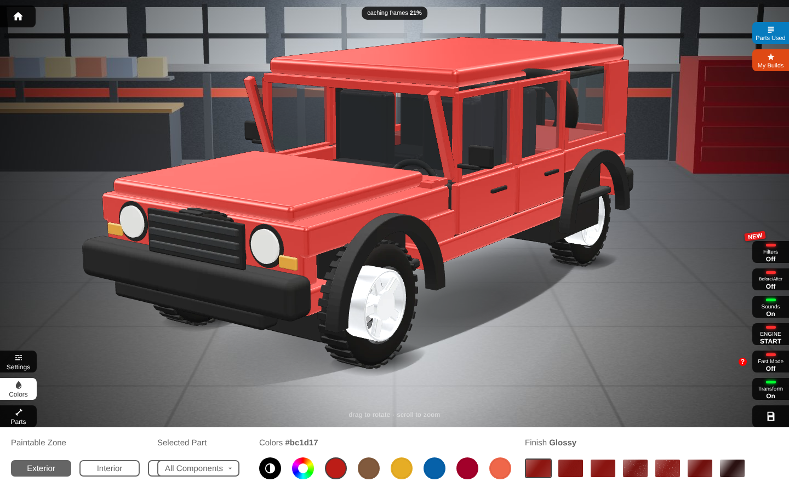

# Micar Tuner

A local, dependency-free car configurator that works the way 3DTuning's vehicle pages work — a **sprite turntable**:
48 pre-rendered rotation frames, each composited in real time from per-part image layers that are recoloured, lifted,
tinted and lit on the fly — but with an **original procedural 4×4** and original art, so you own everything in it.



## Run it
```bash
node server.js            # or: npm run dev  →  http://localhost:5173
```
That's it. No build step, no dependencies at runtime (Node ≥ 18 only for the static server; any static server works).
Open the URL in Chrome/Edge/Firefox/Safari (desktop or tablet; ≥ 1100 px wide recommended).

Controls: drag to rotate · scroll to zoom · ←/→ step frames · left dock = Settings / Colors / Parts ·
right dock = Parts Used, My Builds, Filters, Before/After, Sounds, ENGINE START, Fast Mode, Transform (off = drag pans), Save.

## What's implemented
- Turntable engine (`src/engine.js`): per-frame z-ordering, paint = diffuse × colour + specular gain per finish
  (glossy / matte / satin / metallic / pearl / candy / chrome), glass tint via mask layer, glow layers (head/tail
  lights, light bar, underglow, wheel neon), suspension lift, coarse-first frame caching, "never show a half-loaded frame".
- 20 part categories with 2–4 variants each (hood, doors, tops, bumpers, flares, wheels, tyres, lights, grille,
  mirrors, steps, roof rack, light bar, snorkel, antenna, spare) + 4 build kits, dependent-part rules, prices.
- Paint zones (exterior / interior / wheels) with per-part overrides, 17 factory colours, custom picker, HSL tweak.
- Settings: window tint, suspension, zoom, wheel neon, car neon, lights, rock lights, auto-rotate.
- Parts Used (bill of materials with total), My Builds (localStorage with thumbnails), share link (state in the URL),
  PNG snapshot, photo filters, synthesised engine sound, Before/After.

Not implemented (see `REBUILD.md`): second camera angle, background/template chooser, community features, mobile app
redirect, ads, translations.

## Project layout
```
index.html  src/{app,engine,catalog}.js  src/styles.css   # the app (vanilla ES modules)
server.js                                                 # zero-dependency static server
assets/sprites/<part>/<layer>/fNN_x_y.webp + manifest.json # 5,455 generated layers (19.5 MB)
assets/bg/garage.jpg                                      # rendered backdrop (same camera as the car)
tools/vehicle.js        # the procedural SUV: parts, variants, materials, occlusion policy
tools/render-page.html  # three.js scene + layer renderer (two-pass occlusion, bbox crop, WebP encode)
tools/render-sprites.mjs# Playwright driver: writes sprites + manifest; --preview for QA composites
tools/shot.mjs, tools/hud_diff.py, tools/composite-test.html   # QA helpers
recon/   # evidence from the original (SPEC.md, tokens/structure/api JSON, screenshots)
REBUILD.md, diff/, docs/screenshots/                       # spec, parity results
```

## Re-rendering the vehicle (optional)
Only needed if you change `tools/vehicle.js` or `tools/render-page.html`.
```bash
npm install                       # three + playwright (dev only)
npx playwright install chromium   # once, if you don't have a Playwright Chromium
npm run render:preview            # QA composites → tools/preview/*.png
npm run render:sprites            # full set: ~14 min, writes assets/sprites + assets/bg
node tools/render-sprites.mjs --frames 0,12 --parts body/stock   # subsets
```
If Playwright is installed somewhere else, point at it: `PLAYWRIGHT_PKG=/path/to/node_modules/playwright`.
Headless rendering is CPU-only (SwiftShader) and works fine; ~17 s per frame.

## Extending
- **New part**: add a `this.add({...})` call in `tools/vehicle.js` (category, variant, name, price, `group`, `layers`,
  `paintable`, `requires`), render, then list the category in `src/catalog.js`. Side-symmetric parts use `split: true`.
- **Your own vehicle**: replace `Vehicle.build()` with a loaded glTF split into the same part groups; everything
  downstream (manifest, engine, UI) stays the same.
- **Real prices / DMS**: `price` on each variant and the paint-finish prices in `app.js → partsUsed()`.
- **Keys/secrets**: none needed; nothing leaves the browser.
